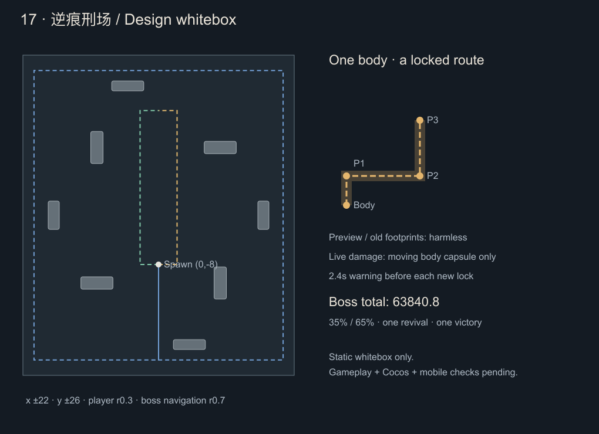

# 第十七关设计 · 逆痕刑场

2026-10-22设计稿。**已在本地0.41.0实现并开放**，实施与验证以[开发记录](stage-17-implementation.md)为准。本批未上传，微信开发后台仍为0.40.2、16关。遵循[统一规则](level-design-rules.md)、[AI基础](ai-tactics-0.40.0.md)、[移动规则](enemy-movement-0.40.1.md)与[精英/Boss选招](elite-boss-tactics-0.40.2.md)。

## 1. 定位：离开旧路线，读懂实体追击

本关比第十六关更强调路线判断。第一形态用直冲、折步和近身横扫教学；一次死亡复活后，Boss会截取玩家**已经实际走过**的路线，预告后沿拟合折线追击，再加入返身或停步横扫。持续沿原路绕圈、躲第一下后立即回到身后，不能解决所有招式；及时离开已公布路线、等整组结束后反击仍是可靠应对。

与第十六关的差异：没有留在原地再次爆发的骨痕，也没有旧址与新身体两个虚拟来源；本关冲锋伤害跟随真实身体。地上旧脚印、整条虚线预警和经过后的残影均无伤。近身扇扫则单独画出实际扇形，不能把两种判伤混为一谈。

- 候选ID17，通关16解锁，无指定武器、品阶、移速或成就门槛。
- 延续360秒生存、随机成长、四武器/四被动；不新增守点、护送、搬运或玩家按钮。
- 四种普通角色、两种精英、三轮精英；最多100实体、特殊威胁6、全场两危险预约槽。
- Boss一次复活、两种形态，不套70%/35%三阶段；精英不复活，初登场与返场均为同时点正常生命100%。
- 拟新增2成就（28→30）；裁决圣剑开放精良/稀有两档候选，不增加武器系列，随机池仍十四系列。

## 2. 难度与生命预算

难度提高主要来自路径与时序：第一形态教会完整路线，第二形态需要区分顺迹、返程和冲锋后的新横扫。长预警期间仍能攻击Boss，读懂恢复窗口会明显改善输出，不给存活Boss额外无敌、不读取玩家DPS调高生命。

沿用现有 `StageGrowth` 数学公式，令 n 为关卡：

- 参考有效输出：`D(n)=343+217×(1−exp(−(n−1)/5))`。
- 参考有效战斗时间：`T(n)=60+60×(1−exp(−(n−1)/6))`。
- 整场生命：`H(n)=D(n)×T(n)`，两条命共享这一预算。

|项目|第17关候选|
|---|---:|
|参考有效DPS|551.154602|
|两命合计目标有效战斗时间|115.830993秒|
|两命合计实际HP|63,840.784775|
|第一命35% / 第二命65%|22,344.274671 / 41,496.510104|
|相对16关合计HP增长|约1.016%|
|普通/精英生命系数|3.106869161 / 3.719678641|
|恢复倍率|0.35下限|
|普通接触配置倍率 / XP倍率 / 药剂|1.80 / 1.45 / 42|
|最终胜利金币|420|

HUD可分别向上显示22,345、41,497，但逻辑使用浮点预算；不把各自HUD取整数相加当真实总HP。约116秒是固定参考预算，不是计时锁血、所有配装保证时长，也不含死亡演出。新圣剑品阶完成后重新验证参考输出；必要时离线统一校准参数，不能在战斗中针对玩家装备动态抬血。

当前装备接近上限，平滑趋近公式在后期增幅会减小，这是有意避免血量无止境膨胀。后续强度来自新判断、组合和可利用窗口；新增装备上限后再重新校准输出曲线。

## 3. 场地与美术

地图x±22、y±26，出生(0,−8)，基础速度4.2、玩家半径0.3、Boss导航半径0.7、48像素/单位。中央半径6保持开阔；八座低矮刑台挡身体，不挡友方攻击。Boss冲锋是身体运动，不能穿台；横扫的有限扇形不被刑台截断，台面上同样显示真实预警，选关/HUD明确说明。

|刑台中心|半宽/半高|
|---|---|
|(−10,−11)、(10,11)|2.6 / 1.0|
|(−10,11)、(10,−11)|1.0 / 2.6|
|(−17,0)、(17,0)|0.9 / 2.3|
|(−5,21)、(5,−21)|2.6 / 0.8|

内路x±3与外环x±20.2、y±23.5贯通。使用同一矩形地图导航，不引入动态堵路、不可破坏新墙或永久危险地板。

美术继续使用Cocos Graphics墨线：暗铁、灰骨、锈红枷具，轨迹以断续脚印和方向箭头表达。第一形态「缚枷刑官」低伏四足、双肩横枷、前臂宽刃；第二形态「脱枷逐痕者」直立双足、两条长镰臂与向后展开的破枷轮廓。胸口同一枚刑印维持身份联系；破枷碎片只作短暂无伤演出，不落成机关。与16关棺甲/肋翼、15关投架、13关离体刃区分。

## 4. 轨迹、预警与真实判伤

### 4.1 历史来自实际运动

保存最近3秒**游戏时间**内玩家经过地形碰撞后的实际分段路线，包含转弯、停顿与墙滑。暂停、升级选择和后台暂停不推进轨迹年龄；不能用输入方向或未碰撞的理论终点代替实际位置。历史只用于预告前选路，不预测玩家将来的输入。

候选从历史中截取连续片段：历史部分最多4个节点，起点须距Boss当前真实身体≤1.2；连接段也从当前身体出发计入路线，总长≤7.2。可拟合近似共线/曲线路段，但所有原样本到相应拟合段偏差≤0.12，重新检查整段Boss半径0.7的地形通路，不得用折线捷径穿台。节点过多则截取更短连续片段，不跨过大转弯直接连线。

只有长度≥3.6且拟合历史路段存在至少35°拐角、原始样本在拐角两侧具有相应方向变化的候选算“有效辨迹”挑战；普通出招允许更短合法路径。零长度、站定、历史不足、路线放不下或无联合退路时，改用完整预警的锁点直冲，不把站定时长变成额外惩罚。最多1.5秒真实导航接近候选起点，失败后换招，不能永远追一个过时脚印。

锁定后保存完整节点、每段开始/结束时刻、移动速度、危险半径、命次/组/段和来源ID。真实身体按弧长逐段移动，经过节点不瞬移，不重新追踪玩家。提前清楚显示所有已锁段、箭头与编号；未来节点表示实体将经过的位置，不能在实体尚未到达时从该点独立发伤。

### 4.2 冲锋只伤当前身体

冲锋的伤害足迹是身体中心圆：缚枷形态半径0.65、脱枷形态0.55，普通特殊0.42；与玩家0.3半径相交才伤。预警的整条走廊不是持续伤害区，身体经过后可立即穿过尾迹；停步、折角等待、预警和余影均无冲锋伤害。

低帧需按每个路径节点、蓄力/移动/等待/返回边界拆分双方的实际运动段。每段内解相对线性运动的最近距离，与两半径之和比较；不能拿整个折线路径、两端直线、包围盒或端点采样代替。绘制与判伤共享当前身体轨迹和时钟，身体被冻结时也不能显示在旧位置。

每个往程/返程各最多一次命中尝试；不同段同属一次冲锋不能重复叠伤。整组关闭额外普通接触伤害；寻敌且无活动招式时才走原接触规则。身体在预警、移动和收招时都可被正常武器伤害，不增加闪避率或存活无敌。

### 4.3 新横扫单独公布

横扫为实心有限扇形，与16关已验证的扇形几何规则一致：检查径向边、有限圆弧和玩家半径，含轴心，不用整圆或三角形近似。只有实际0.20秒半开窗口有伤，单次去重。

若横扫是在冲锋到位后才重新锁定，则必须从**当时实际身体**和当时玩家位置出发，另给完整2.4秒预警。不能预告一条冲锋，抵达后突然追加无预告横扫。新扇形须重新做全场已预约危险与人群下的联合逃生检查；不合格则取消后续横扫、正常收招，本组不计完整机制挑战。

### 4.4 预约、取消与退路

一只身体的整条串行招式占一槽，含预警、移动、折角等待和未来返程；槽在整组结束前不释放。两精英各占一槽，禁止第三条危险、额外地面伤害或隐形冲撞。Boss本身不强制用满两槽，难度不能简单等于塞满屏幕。

冻结或死亡取消尚未开始的冲锋腿；已开始的身体腿在冻结点立即停住并关闭冲锋判伤，不偷跑到端点，不补播剩余腿。若扇扫已经释放，则完成其原定0.20秒窗口，不延长；未释放的扇扫取消。冻结者保持可受伤，待已发危险结束后进入完整收招，解冻不瞬间恢复旧冲锋。

每次发布检查身体路线、完整预警可见、地图边界/HUD、两槽、基础4.2移速与0.35秒反应、人群下至少一条无伤路径；不依赖靴子、冻结、冲刺键、无敌帧或指定武器。到位后的新锁定再检查；不合格就换招/延迟，不缩窄或藏掉预警强行放置。

## 5. Boss：两种形态的打法

开战显示「缚枷刑官 · 余命2」，提前说明“枷裂后复生，逐迹追猎”。首次归零后等待已释放扇扫结束，完整播放2.4秒脱枷演出，再以预分配的65%总预算复活；第一命不发胜利、经验结算、通关金币或重复药剂。第二次归零才最终结算。复活后清空旧命轨迹候选和目标临时状态，玩家武器、冷却、经验和权益保留；历史不足时正常使用直冲。

两命总归属同一遭遇，复活前已发伤害也计入整场Boss无伤。跨命弹体/持续场保留原寿命、节拍和命中去重，不打尸体、不让同一发因复活清表额外打一次。复活倒计时由可选生命周期策略管理，暂停不走时，失败/退出停止；手动存档仍是账户存档，不承诺新局中续战功能。

### 缚枷刑官：先学直冲、折步、横扫

寻敌近速1.6，远距实际导航追近5；身体冲锋速度4.6。普通攻击完整预警2.4秒，扇扫0.20秒；下表恢复为基础值，最终统一乘0.35。

|招式|完整动作|预约|伤害|基础恢复 → 实际|
|---|---|---:|---:|---:|
|A 枷身直裁|锁定当前玩家方向，身体直冲5.2；路线公布后不追踪|1|26|4.6 → 1.61秒|
|B 折肩踏刑|两段各3.0的折线，第二段转±60°；折点停0.6秒无伤，方向从整组发布起固定|1|26/整次冲锋|5.0 → 1.75秒|
|C 枷前横裁|当前身体原地r3.2、半角70°实心横扫；绕背或离开有限范围|1|26|5.2 → 1.82秒|

A教侧移，B要求看完整路线而非只躲第一段，C处理永久贴身。几何失败换招，正常输出可以快速击杀，不锁血等待教学播完。

### 脱枷逐痕者：旧路、返身与到位后新判断

近距实际寻敌2.4，远距追近5，冲锋5.2；仍是完整2.4秒预警。身体外形明显变化，不只换色增伤。

|招式|完整动作|预约|伤害|基础恢复 → 实际|
|---|---|---:|---:|---:|
|A 循痕追猎|从实际身体接入可达历史片段，沿旧→新方向追击，总长≤7.2；不足则锁点直冲5.2|1|26|5.0 → 1.75秒|
|B 返迹处刑|先完整执行一条有效循痕路径；抵达后再明确预告2.4秒，沿刚经过的同一条路径反向返回|1|去/回各28|5.4 → 1.89秒|
|C 逆痕截尾|接入可达的新→旧历史片段，沿反向路线冲锋；到位停身，从真实身体重新锁向玩家、预告2.4秒后r3.4/半角75°横扫|1|冲锋26 / 横扫28|5.6 → 1.96秒|

B不能在倒放时改变节点或身体瞬移；第二次预警明确画返程箭头，经过后的地面在等待期间仍无伤。C的横扫源在到位后才存在，不把未来端点当虚假身体；扇扫不合法就跳过该后段。

选招沿用候选比较：合法性与联合退路优先，未使用可用招式优先，再看当前玩家位置覆盖、可用历史和上一招。B必须有真实已走路线；C必须有合法反向路线，不能把任何直冲标成辨迹成功。三招均有明确收束恢复，不能连续随机出最强招、永远不给输出窗口。

## 6. 普通角色、精英与六分钟节奏

以下为敌人原型系数，实际生命按现行生成时间公式只乘一次；不把表内原型值再当最终HP。普通追兵增长到90秒封顶，特殊/精英到240秒封顶。

|候选ID / 名称|生命系数|寻敌速度|接触基础值|威胁 / 上限|职责|
|---|---:|---:|---:|---|---|
|shackleshard 锁屑刑徒|1.24|1.88|12|0 / 100|基础追兵；侧翼与群体分离沿用0.40.1|
|fettersprinter 曳枷刑卒|2.25|1.12|14|2 / 2|30秒起，2.2秒预警后实体直冲4.8，速度3.8、伤22|
|trailhound 寻痕缚兽|2.30|1.16|14|2 / 2|65秒起，短历史路线≤4.8/最多3节点，2.2秒预警，冲锋4.4、伤22|
|turnwarden 折步钩卫|2.30|1.14|14|2 / 1|95秒起，直冲3.6后另给2.2秒返程预警，同路返回；去/回各22|
|trailmarshal 领痕刑使|12.00|1.16|24|3 / 1|压制型，完整历史冲锋后停步横扫，各新锁定2.4秒，伤26|
|reversejailer 返步狱长|12.50|1.18|26|3 / 1|侧翼型，完整历史冲锋后同路返程，独立2.4秒预警，去/回各26|

240秒上限下，三类特殊约377.48/385.87/385.87HP，双精英约2,410.35/2,510.78HP；追兵90秒上限约150.25HP。精英返场仍为正常100%，不折血。普通护甲20%、特殊35%、精英50%、Boss55%，恢复暴露沿用通用策略：Boss护甲上限15%、精英20%且暴露伤害×1.25；裂甲每层Boss减15个百分点、其他减35个百分点。

- 0～30秒基础成长；30～65直冲教学；65～95短轨迹；95～125返程教学，逐个引入。
- 125～135、215～225、295～305为精英前休整，不新增特殊。135秒领痕刑使、225秒返步狱长各单独教学。
- 265～295组合已教普通特殊，305/311秒双精英返场；延迟时最晚328/334，过期不补播。
- 双精英分别压制与侧翼，等待换位有1.5秒上限，准备好且有槽时交回原调度；独立招式预约两槽，不能叠加第三招。
- 350秒停止新增特殊，360秒Boss等待精英/旧危险结束和至少3秒交接。Boss不与双精英叠组。
- Boss仅补锁屑刑徒，目标24～28，每3秒最多6名，9秒补/5秒停；恢复、第一命倒下、等待余波和复活期间停补，不积压补发。

补给按整场合计**实际损血**25%/50%/75%各一次，药剂42；第一次约在第一命剩28.571%，其余在第二命剩76.923%/38.462%。复活不重送，溢出不伪造损血，三次总额仍是三瓶。

## 7. 配套成长与经济

### 两成就，挑战奖励继续考验机制掌握

- `tracecourt_clear`「刑场脱枷」：最终击败脱枷逐痕者。第一命归零不计，奖励通关图鉴标记，金币420只由正常胜利结算一次。
- `trace_twelve_paths`「十二途逆痕」：从发布时冻结的十四系列中任选十二种实际起手，每种五组合法双改，分别完成**左转辨迹/右转辨迹**两类合格最终胜利，共120格。每次胜利只记一格，方向绑定第二命首次完整合格A组的主转角；重复同方向同配方不增加进度。

每局起手8级、合法双改保留；第一形态完整无伤躲过B并在收招期近身造成实际武器伤害；第二形态完整躲过真实辨迹A、完整去回B和逆痕加横扫C，并在B/C各自整组收束后的恢复期近身反击。辨迹要求历史有效长度≥3.6且主转角≥35°，方向只看历史部分，不含身体接入段；以绝对值最大的历史拐角为主转角，同值取路径上最早者，世界坐标逆时针为左、顺时针为右。近身反击须在对应整组结束后的实际恢复窗口、距离活身体≤2.8，由自身装备系列或合法派生造成正实际伤害；打尸体、无伤演出或提前留下的零伤事件不算。取消、退化直冲、横扫取消、未完成返程均不计。整场Boss来源实际扣血0，两命与转命余波合并计账。

奖励「逆痕断枷者」称号与顺逆双箭徽纹，无属性、额外金币或随机权重。最低120场合格胜利是双向/配方覆盖范围，主要难度应来自顺逆、返程和到位横扫的掌握，不把单纯加刷关次数作为机制本身。图鉴提供12系列×5配方×左右两格明细和机制勾选；不强制引魂灯或缚影缝针起手，不命名全游戏终极成就。

保存 `traceQualified` 候选字段（version、冻结配方键、左右标记），按runId只提交一次；方向与机制事件必须绑定同一遭遇、命次、来源和真实完成组。旧16关60格等条件不扩大，旧胜利不补算新进度。合法高输出可不等招式直接过关，只是未满足挑战，不给Boss锁血补播。

### 裁决圣剑：先补精良、稀有两档

本批建议普通「裁决圣剑」→精良「誓纹裁剑」360金币→稀有「断律圣裁」720金币，合计1,080；史诗留后续，不出售或预告为已开放。金币进阶是常规成长路线，不要求刷完120格挑战才能获得。本批不新增系列、不重复占随机池位置，原购买/成就解锁路线保持。

- 精良：单刃变双脊短剑身与断开的菱形护环，锁点符号改为双层短刻线；落剑形状、命中裂纹和图标都改变，伤害倍率1.25。
- 稀有：中空三棱剑身、悬浮分节护手，预告用分段裁线、命中为有限六棱圣纹；基础落剑、十字/烙印/剑雨改造的视觉分别适配，伤害倍率1.60。
- 保留锁点重击职责，攻击延迟、半径、数量、频率与烙印比例不增加，不追加追踪、自动必中、破甲或控制。Boss移动时有落空代价，收招期价值更高；不专门削弱本关以外的武器。
- 无被动/改造、8级参考职责预算：精良106.25～156.25DPS，稀有136～200DPS（普通85～125乘品阶系数），仅验收区间，不是隐藏运行时封顶。
- 所有伤害与派生在快照中只继承一次品阶；验证四改造、五组合法双改、复制/范围/持续/冷却组合、移动/护甲/分散与四槽整队。未通过平衡与真实构建，不收费、不写入可用上限。

第17关胜利420金币，从零购买全两档需3胜1,260余180；从精良升稀有需2胜840余120。1～17首胜基础金币合计4,420，不能只用首胜收入宣称所有系列可升满，也不加17关专用币。图鉴保留武器简介，以升级小图标提示，显示目标形态、价格和差额；最高实际开放仅稀有。

## 8. 接入与验收

先搭白盒 → 单怪 → 单精英/双精英 → 两命Boss → 完整成长 → 美术/横屏 → 真机。复用 `StageStrategy` 的地图/伤害/生命周期及通用候选选择，独立 `TraceCourtMap/Geometry/System` 处理历史与实体路线；不要把第17关判断堆入公共世界、存档或武器行为。该批预计新增6敌人（106→112），2成就（28→30），2品阶形态（30→32）；运行时注册要以内容审计结果为准。

必须覆盖：

1. 历史取真实墙滑路径、近似偏差/节点上限、路径可达、截取顺序、方向判定，复杂历史和站定均可正常回落出招；不会永远追过期起点。
2. 每个节点/停步/往返边界的连续判伤、圆帽、擦边、低帧双方同时移动、旧脚印/整条预警/残影无伤；当前身体画面与判伤一致。
3. 冻结中途立即停身且不复播，死亡取消未来腿、已发扇扫原时收尾、两命间来源保留、同帧致死/溢出/重复命中、一次复活与最终一次结算。
4. 采用同配装/同种子成对检查站定、持续绕圈、左右换向、贴边角、背台、贴身绕背、招式间隙；两种形态和候选失败回落均覆盖。两精英轮换、预约与联合退路不得只在空场验证。
5. 新伤害机制不依赖通关测试才能验证；记录多配装/多种子的命次时间、超时、失败及死因，机器人结果不当真人胜率。确认近身、范围、单体配装都有取舍与可利用输出窗口。
6. 740×390、844×390和桌面实际Cocos检查完整路线、方向/段号、双命HUD、扇扫的新预警、两形态轮廓；墨迹特效不得盖住人物和危险边界。
7. 0.40.2账户/未知可选字段/主备/三手动位/坏字段/写失败/冷重载兼容；仅通关16者正常新增17入口，不丢金币、旧成就和消费记录；新两品阶交易取消/重复确认不扣错费。
8. 补齐StageId、策略、敌人归属与美术、地图配色、HUD、选关、战报、结算、图鉴、奖励和可用最高品阶，执行内容审计与完整验证；当前设计稿本身不修改这些运行时表。

## 9. 当前已完成与待验收

`node tools/check-stage17-design.mjs` 已输出[地图](../artifacts/stage17-design/layout.png)、[SVG](../artifacts/stage17-design/layout.svg)与[白盒结果](../artifacts/stage17-design/whitebox.json)。0.5网格下玩家半径0.3共8,521格、Boss半径0.7共7,937格均连通，三条路线采样可通；四个孤立相对运动判伤例和35%/65%生命预算算术通过。

上述为设计阶段静态证据；后续已完成运行接入、连续判伤、动态联合退路、品阶预算、Cocos浏览器及双平台构建，详见开发记录。静态白盒与自动诊断均不代表真人胜率或微信真机体验，本次未上传后台。
