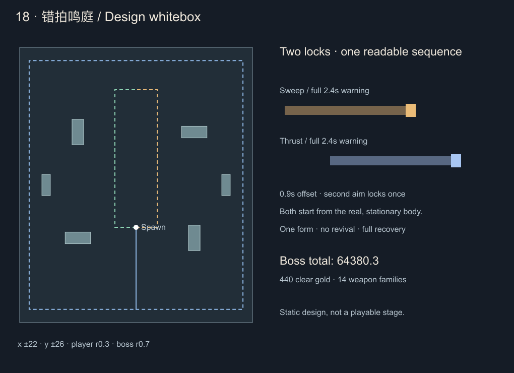

# 第十八关设计 · 错拍鸣庭

2026-10-22。用户确认第18关起借鉴同类游戏的敌群职责、精英/Boss分工和任务成长思路。本稿已在本地 **0.42.0实现并开放**，实施及验证以[开发记录](stage-18-implementation.md)为准；本批未上传，微信后台仍0.40.2。以[统一规则](level-design-rules.md)及[第17关实施](stage-17-implementation.md)为设计基线。

## 1. 核心判断与边界

本关教玩家「躲过第一击后，继续读第二次锁定」。第16关考旧位置，第17关考历史路线，本关改考横向/纵向攻击的错拍衔接。保留六分钟生存、随机升级、四武器/四被动、100实体、特殊威胁6、两危险槽，不增加闪避键、护送、守点、强制任务或专用货币。

采用《土豆兄弟》的敌群职责与压力段思路、《深岩银河：幸存者》的近远分工思路；具体数值、预警、身体位置和退路以本项目基础速度与画面为准。**18关单体Boss教错拍；19关双体协同仅为后续方向，未预先批准其具体设计。** 不连续第三关强加复活，也不把“多一个Boss”当成翻倍生命和伤害的理由。

候选ID18，通关17解锁，无指定武器、成就、品阶或移速门槛。普通胜利可以迅速击杀Boss，不锁血等待招式教学或成就完成。

## 2. 数值与成长预算

继续使用现行公式，不因玩家本局DPS改变血量：

`D(n)=343+217×(1−exp(−(n−1)/5))`

`T(n)=60+60×(1−exp(−(n−1)/6))`，`H(n)=D(n)×T(n)`。

|项目|第18关候选|
|---|---:|
|参考有效DPS|552.758000|
|目标有效战斗时间|116.471012秒|
|整场Boss生命|64,380.283535|
|相对17关增长|0.8451%|
|普通/精英生命系数|3.126220436 / 3.744826355|
|恢复倍率|0.35下限，不再缩短|
|普通接触配置倍率 / XP倍率 / 药剂|1.80 / 1.45 / 42|
|胜利金币|440，最终死亡结算一次|

Boss一条生命，无复活、锁血或无敌转态。圣剑史诗开放后须复查多配装实际输出与四槽整队时间；公式是离线基准，不是保证每种配装打满116秒。装备输出上限未增长时不无限指数堆血。实际累计损血25%/50%/75%各落一瓶药，跨阈值去重，不按未扣除的溢出伤害补发。

## 3. 地图与造型

场地x±22、y±26，出生(0,−8)，基础速度4.2、玩家半径0.3、Boss导航半径0.7，48像素/单位。中心半径6保持开阔。六座低鸣台挡身体，不挡友方攻击；有限扫击/刺击可越过低台，预警必须画在台面上。低台不能误画成遮挡武器的高墙。

|鸣台中心|半宽/半高|
|---|---|
|(−11,−10)、(11,10)|2.4 / 1.1|
|(−11,10)、(11,−10)|1.1 / 2.4|
|(−17,0)、(17,0)|0.8 / 2.0|

内侧x±4通路和外环x±20.2、y±23.5贯通，不加永久地面伤害或动态封死出口。

美术沿用Cocos Graphics墨线。青铜、暗青石、象牙白为主，区别于17关的枷具锈铁。普通追兵为碎磬背壳，刺手长臂持音叉，远程角色展开窄排管，支援者背负有可见连线的共鸣架。Boss「双律监奏」是宽肩立像，一臂宽磬刃、一臂长鸣枪；胸前双摆锤表现两次锁定。它只有一个真实身体，两条手臂不伪造额外独立来源。

## 4. 两次锁定与危险规则

Boss/精英新锁定均给完整2.4秒预警，单次伤害窗口0.20秒。普通特殊给2.2秒。角色在整组预警与释放期间驻足，不能锁定后平移身体、转动旧预警或从未来位置攻击；寻敌及下一组前才真实导航换位。

一组双拍的标准时间：

|事件|时间|规则|
|---|---:|---|
|第一拍锁定|t=0|记录当前真实身体与当前玩家方向|
|第二拍锁定|t=0.9|从同一驻足身体记录此时玩家方向，独立完整预警|
|第一拍有效|[2.4,2.6)|按第一份快照判伤|
|第二拍有效|[3.3,3.5)|按第二份快照判伤|
|整组收招|最后已发窗口结束后|进入完整恢复，不在两拍之间提前暴露/重开攻击|

第二拍可参考锁定前的真实位置，锁定后不再跟随。两次预警分别用金色单刻线与蓝白双刻线、序号1/2和倒计时表达；不能只依赖颜色或声音。HUD显示「扫→刺」「刺→扫」「左右错扫」及两拍状态。

单体串行双拍占一个预约槽，另一槽不能被隐形附加伤害使用。双精英各自只发布一个完整单拍，两者错开锁定0.9秒；两槽从各自预警开始持有到对应伤害结束，不用一个槽塞两只实体。若第二名尚未准备好，则不伪造同步；本轮作为单独攻击处理，不计配合挑战。

每次新锁定都检查已有危险、地图、人群与基础4.2移速/0.35秒反应下的联合退路。第一拍承诺后，第二拍不合法则取消第二拍并清楚熄灭其标记，完成第一拍后收招；不能挪动第一拍给第二拍腾位置，也不能缩窄判伤但保留大预警。候选选招优先合法性、招式覆盖及站位适配。

扫击用有限实心扇形与玩家圆的精确距离；刺击用从真实身体伸出的有限胶囊，显示长度、半宽和圆帽。刺击不是远处凭空出现的线，也不是整片矩形判伤。预警、手臂连接装饰、窗口外余光均无伤。低帧按锁定与有效窗口边界裁剪玩家连续运动，不能只采样帧末。每拍最多一次命中尝试；整组关闭额外身体接触叠伤。

冻结/死亡取消未释放的后拍；已经生效的一拍只完成原定0.20秒窗口，不延时。冻结不能让已锁身体漂移。任何取消、冻结或击杀导致的缺拍均不计完整配合挑战。暂停/升级/后台暂停不推进时序，失败后不继续派发。

## 5. 四类普通敌人与两精英

下表为原型配置，生命仍只应用一次生成时成长与关卡系数；追兵增长90秒封顶，特殊/精英240秒封顶。精英初登场与返场均正常100%生命，不加返场折扣或隐藏增强。

|候选ID / 名称|生命系数 / 寻敌速度|接触基础值 / XP|威胁 / 上限|职责与攻击|
|---|---|---|---|---|
|chimeshard 磬屑行徒|1.26 / 1.90|12 / 1|0 / 100|基础追兵，侧翼追击和群体分离；接触判伤沿用通用规则|
|forklancer 分律刺手|2.30 / 1.14|14 / 2|2 / 2|近侧逼位；驻足预告2.2秒，长4.4/半宽0.35刺击，窗口0.20、伤22，实际收招1.2秒|
|pipereader 列管鸣侍|2.35 / 1.10|14 / 2|2 / 2|偏好射程3.5～5.5；驻足预告2.2秒，长6.2/半宽0.32有限音束，窗口0.20、伤22，收招1.4秒；接近或撤退有时限|
|resonancebearer 共鸣架使|2.00 / 1.02|12 / 2|2 / 1|支援优先目标；半径4内基础追兵护甲20%→35%，不叠加、不加血/速度，不作用于特殊、精英或Boss；自身无远程招式|
|broadcantor 展磬领奏|12.20 / 1.16|24 / 8|3 / 1|压制精英；r3.6/半角65°横扫，预警2.4秒、伤26，基础恢复5.0×0.35|
|needleconductor 锥律督奏|12.70 / 1.18|26 / 8|3 / 1|侧翼精英；长6.2/半宽0.42刺击，预警2.4秒、伤26，基础恢复5.4×0.35|

共鸣加甲只在实际活体与真实距离满足时生效，来源死亡或离开范围立即失效；连线和护甲纹清楚可见。不得改变敌人伤害、攻击时钟或已经公布的几何。支援自身不受自己增益，护甲不超过本表基准。范围清群可同时打到支援与受益者，单体配装可先切掉支援，不强制先杀才能伤害追兵。配置登记优先目标特征，不把新名字堆入公共选敌正则。

两精英配合前，压制者靠近可扫位置，侧翼者选另一方向的合法刺线；等待换位最多1.5秒，失败退回公平独立调度。首发权轮换，不能因固定遍历顺序让一名永远不出招。两槽被占满时普通特殊不发第三条危险，共鸣不增益精英。

普通护甲追兵20%、特殊35%、精英50%、Boss55%；恢复暴露沿用通用策略，不新增护甲层。精英恢复护甲上限20%、Boss15%，暴露伤害×1.25，裂甲按现行规则结算。支援增益不能覆盖恢复暴露上限。

## 6. 六分钟教学与组合

- 0～30秒：基础追兵与成长；30～65秒只引入刺手，65～95秒单独教学列管鸣侍，95～125秒加入共鸣支援，支援首次出现最多配基础追兵。
- 125～135、215～225、295～305秒为休整，不新增特殊；135秒展磬领奏、225秒锥律督奏分别单独教学。
- 145～205秒刺手/鸣侍轮换，235～265秒支援与基础追兵，265～295秒已教学职责组合；特殊总威胁≤6，不能同时填满各自数量上限。
- 305/311秒双精英正常满血返场，最晚328/334秒，过期不积压补播。第二名完成到场后才启用错拍协调，不从地图外立即打配合。
- 350秒不再新增特殊；Boss至少360秒，等待精英与现有危险结束并留3秒交接。Boss登场前旧普通特殊停止新预警，已发窗口完成后清楚退场，不额外掉经验/金币、不触发击杀成就；不能无提示瞬删活动攻击。
- Boss仅补基础追兵，目标24～28、每3秒最多6名，9秒补/5秒停；恢复期间停补，不积压。Boss战不加入共鸣支援或额外特殊，避免偷偷变成三来源危险。

不为阻止挂机突然生成贴脸敌人。固定位置需要被正常追兵、合法换位与可见招式覆盖；移动成功仍应降低受伤风险。

## 7. Boss：双律监奏

单形态、单生命，三种完整双拍为招式组，不是三个血线阶段。寻敌近速2.2、远距追近5.0，偏好距离2.4～3.4；锁定后保持真实身体驻足。玩家始终可攻击Boss，读懂整组后的暴露窗口有额外收益。

|组|第一拍|第二拍（t=0.9新锁定）|伤害|基础恢复→实际|
|---|---|---|---|---|
|A 扫后点名|r3.6、半角65°横扫，朝第一次锁定方向|长6.2、半宽0.42刺击，朝第二次锁定方向|26 / 28|5.6→1.96秒|
|B 刺后回磬|长6.2、半宽0.42刺击|r3.6、半角65°横扫|28 / 26|5.8→2.03秒|
|C 双侧错扫|第一次玩家方向−45°的有限横扫|第二次玩家方向+45°的有限横扫|26 / 26|6.0→2.10秒|

C两拍均r3.6、半角65°，按世界坐标标明左右；不是原地360°全覆盖。三组均使用第4节完整时序，第二拍不能读玩家未来输入。第一组优先A教学，之后候选比较优先未展示的合法组，再考虑站位与上次选择；不固定永远A、不随机连放最强组。不要求血线以下永久加速。

远离范围、侧移、绕背都可在适当时机成立；不能人为规定“跑得正确也必须受伤”。玩家离远时Boss真实接近，角落不合法时换位或换组；检查贴身、边缘、障碍背后及持续绕圈，不允许所有招永久被同一障碍拒绝。每组结束前不接第三拍，收招期间完整保留反击时间。

## 8. 两成就与圣剑史诗

候选新增2成就（30→32），不新增系列（仍14）。

`counterbeat_clear`「断奏鸣庭」：最终击败双律监奏；通关金币440只由正常结算发放，成就不另发同额金币。

`counterbeat_mastery`「六律拆奏」：六个冻结起手职责中，每类用两种不同实际起手完成合格胜利，共12份不同系列认证；同系列重复不增加。类别如下，后续新增武器不反向扩大旧挑战：

|类别|冻结候选|
|---|---|
|近身应对|飞刀、寒霜脉环|
|锁点爆发|烈焰火球、裁决圣剑|
|纵列打击|贯阵骨矛、裂甲飞轮（系列ID wheel，不限制当时品阶）|
|分散追猎|幽灵伙伴、天降落雷|
|布场引敌|圣水瓶、符印地雷|
|破甲/协同|镇钟重锤、坍缩黑洞、引魂灯、缚影缝针中任选两种|

每局起手达到8级并保留两项当版合法改造；双精英同场期间完整无伤躲过一组真实错拍配合，再在对应精英完整恢复期造成正实际装备伤害；Boss战实际扣血0，A/B/C各完整处理两组，每组第二拍结束后在完整恢复期、距离真实身体≤2.8造成正实际装备伤害。组被取消、缺拍、仅独立单拍、击杀未结束组、打尸体及无敌碰撞均不算。所有反击可来自该局装备系列或合法派生，不强制只靠辅助起手本体击伤。

其中“双精英无伤”只约束这组配合的实际窗口，不追溯此前整局无伤；Boss无伤覆盖整场Boss来源及余波。每次配合必须真实发布双方，按遭遇、组、来源记录；原地远离所有攻击范围也不算机制处理：相关拍若按玩家锁定前最后位置保持不动应可命中，且实际躲过该拍，才计有威胁应对。近身反击窗口不能靠延长组或拖延判伤伪造。

这是少量但严格的组合认证，区别于17关120个方向/配方键，不按关数继续翻倍刷胜。奖励称号「错拍断奏者」与双摆徽章，无属性、额外金币或随机权重。界面提供六类/起手、精英配合和Boss各2组实时勾选；普通胜利不需完成认证，不锁血等待。

保存候选 `counterbeatMasteryVersion:1`、`counterbeatMastery:[Skill]`，严格校验冻结14系列，去重上限14；完成按六类各≥2判定。只记录合格最终胜利，用runId去重。可选字段损坏只修该字段，保留金币、关卡、旧成就、进阶和三手动位，不用旧通关补算。

圣剑本批建议稀有「断律圣裁」→史诗「寂律天裁」，价格1,440，系列总倍率2.05（相对稀有约+28.125%）。三棱中空剑改为三枚悬浮裁片合拢成刃，落剑与地面纹改为断开的金白多层裁印；基础、十字、烙印、剑雨、图标均要适配。保留锁点延迟、数量、半径、周期、烙印比例，不加追踪、控制、破甲或隐形额外爆炸，不改变其他系列。

8级无被动/改造参考DPS范围174.25～256.25（普通85～125×2.05），仅验收带，不是隐藏封顶。必须检查合法双改、复制/范围/持续/冷却被动、移动/群体/护甲和四槽整队；通过后才收费及开放最高品阶。本批共33形态，随机池仍14位置。

从稀有升史诗需本关4胜1,760余320金币；从普通补齐三档共2,520，需6胜2,640余120。成就认证与金币进阶独立，不把12份认证设为史诗购买前提，不加专属币；图鉴保留简介及升级小图标。

## 9. 接入与验收

设计落地时通过StageStrategy注册地图、伤害、生命周期/阶段信息、目标优先级；新增独立CounterbeatMap/Geometry/System管理双锁定与配合，复用Boss候选比较及精英公平调度。StageHud、EnemyCatalog/美术、AchievementRules/进度、ProgressCodec与成就界面分别接入；普通支援加甲通过关卡伤害策略计算，不改所有关卡的全局护甲。预期新增6敌人（112→118），2成就（30→32），1武器形态（32→33）。

实现验收必须覆盖：

1. 第一拍/第二拍锁定、2.4秒完整预警、半开窗口、去重、台面绘制、低帧连续判伤、暂停与冻结/死亡取消；未锁定的第二拍不能提前伤人。
2. 第二次联合检查失败时只取消未来拍，原快照不改；无合法攻击须有限换位/换招，不永久挂机。
3. 基础速度与两槽下的联合退路，包括中心、边缘、角落、障碍背后、贴身、持续绕圈、躲完第一下返原位；加入真实人群后另验，不能拿孤立图形代替。
4. 共鸣受益对象/范围/不叠加/源死亡立即失效，以及明确展示；先杀支援确实减少压力，清群、单体、近身和辅助配装都保留通关可能。
5. 三轮精英、第三轮满血与公平首发、等待换位上限、Boss交接、旧特殊退场及补兵上限。移动/站定同种子成对检查，不要求机器人完整通关。
6. 两成就真实事件、无伤碰撞排除、重复认证、未来字段、旧档/主备/三手动位、写失败与冷重载；升级取消/重复确认不扣错费，通关金币去重。
7. 完整内容审计、武器/四槽诊断、实际Cocos两种手机横屏、Web/微信本地构建。真人难度及微信真机表现单独记录，上传须按后续明确指示。

## 10. 已有设计证据

`node tools/check-stage18-design.mjs` 生成[地图PNG](../artifacts/stage18-design/layout.png)、[SVG](../artifacts/stage18-design/layout.svg)和[白盒报告](../artifacts/stage18-design/whitebox.json)。0.5网格下玩家8,651格、Boss8,111格均全连通，三条采样路线通过；中心/边缘/角落/鸣台旁共12组孤立双锁定示例均找到基础移速可走出的采样路径，公式算术通过。

上述为设计阶段证据，只说明静态布局与少量双拍例可行。后续已完成运行接入、真实双锁定/判伤、配合/认证、史诗交易、旧档兼容、武器诊断、实际Cocos与本地双平台构建，详见开发记录。静态与自动诊断不代表真人胜率或微信真机体验，本批未上传。
