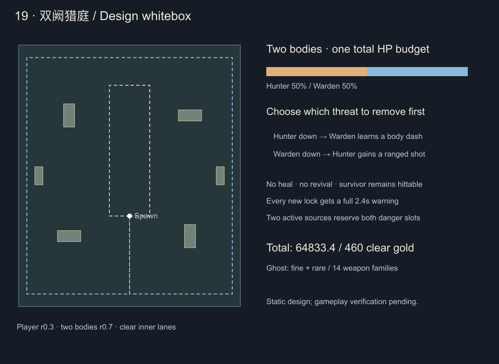

# 第十九关设计 · 双阙猎庭

2026-10-22。**已在本地0.43.0开发并开放，实施与验证见[记录](stage-19-implementation.md)。** 当前19关，微信开发后台仍0.40.2，本批未提交、推送或上传。依据[统一规则](level-design-rules.md)、[十八关实施](stage-18-implementation.md)及用户确认的敌群职责、双体协同方向。

## 1. 本关要学会的选择

第18关考同一组攻击的先后判断，第19关增加「优先拆掉哪一个真实威胁」。Boss同时包含近战「逐猎者」与远程「镇阙者」：前者追击逼位，后者用有限飞矢分路，两者各有身体、生命和可利用的收招。

两体合用一场Boss的生命预算，不互相回血或平均生命。击败其中一体会撤掉双体夹击；存活者保留实际剩余血量，外形改变并吸收对方部分招式。**这是失去搭档后的独猎形态，不是复活，也不再增加一整条生命。** 两种击杀顺序产生不同的后半场。

保留六分钟生存、随机成长、四武器/四被动、100敌人、特殊威胁6、两危险槽。ID19，通关18解锁，不要求指定武器、品阶、成就或移动装备。仍只控制移动，不增加锁定按钮、护送、守点或专用货币。

## 2. 生命、收益与伤害预算

沿用共享固定关卡公式：

`D(n)=343+217×(1−exp(−(n−1)/5))`

`T(n)=60+60×(1−exp(−(n−1)/6))`，`H(n)=D(n)×T(n)`。

|项目|第19关|
|---|---:|
|参考有效DPS|554.070752|
|整场目标有效战斗时间|117.012776秒|
|两体合计生命|64,833.356762|
|逐猎者 / 镇阙者，各50%|32,416.678381 / 32,416.678381|
|相对18关合计增幅|0.7037%|
|普通 / 精英生命系数|3.142647888 / 3.766179239|
|恢复倍率|0.35下限，保留完整窗口|
|普通接触配置倍率 / XP倍率 / 药剂|1.80 / 1.45 / 42|
|最终通关金币|460，只结算一次|

伤害扣到哪个真实身体，就减少该身体生命；没有共享伤害转移、同伴减伤光环或分血回血。范围/贯穿真实击中两体时允许分别结算，两次实际扣血均计入合计损血；不得把同一体的派生命中重复计算。溢出不转移给另一体，不重复计补给。

独猎形态不回血、不补盾、不抬护甲、不按玩家DPS加血；可以在变形期间直接击败存活者。两体合计实际损血25%/50%/75%各一瓶药，第一体倒下不另送一套药或通关金币。目标时间不是计时锁血，不保证所有配装相同时长；幽灵进阶后重新做离线整队输出校准。

## 3. 地图、镜头与美术

场地x±22、y±26，出生(0,−8)，基础移速4.2、玩家半径0.3、两Boss导航半径0.7。中央半径7开阔，给两体站位及穿插留空间。六座低猎台挡身体，不挡友方攻击、敌方飞矢或有限横扫；预警在台面上完整显示，不把低台画成可遮箭的高墙。

|猎台中心|半宽/半高|
|---|---|
|(−12,−12)、(12,12)|2.3 / 1.1|
|(−12,12)、(12,−12)|1.1 / 2.3|
|(−18,0)、(18,0)|0.8 / 1.8|

内路x±4与外环x±20.4、y±23.5贯通，不新增永久危险地板或封死场地的墙。

美术为苍白兽骨、暗松绿、旧银与赭金猎纹，区分十八关的青铜磬管。逐猎者是低伏双前刃兽，长肩胛与短角形成前冲轮廓；镇阙者是高背弩架与长足骨偶，胸前横弩形成远程轮廓。双方肩上同一对缺口猎徽表示同一遭遇，装饰连线无伤。

逐猎者独猎时背部展开搭档式骨弩，短角转为三叉；镇阙者独猎时弩架下沉、长足展开为奔行支架，并长出一枚近侧猎刃。改变轮廓、动作和技能来源，不仅换色放大。

镜头继续跟随玩家，不为了容纳双Boss无限缩小角色。选招前检查两体及完整预警位于当前视口安全区，避开HUD；出招体至少连续可见0.8秒。出场分别有2秒可读到场演出，两体站位作为完整候选同时确认，至少保留两个敌人名额，不能只生成一体当完整双猎开场。候选需两体初始间距≥3.2，且导航半径与已承诺运动不相交；放不下则寻找内侧站位或延迟，不在玩家身上补生成。

## 4. 基础招式与身体职责

所有Boss/精英新锁定完整预警2.4秒，普通特殊2.2秒。已锁方向、起点、长度与时钟不再改变；新的后段必须从到位后的真实身体重新锁定并给完整预警。基础角色能走出联合退路，不依赖靴子、冻结、无敌帧或额外操作。

|代号|攻击|真实危险|Boss伤害|
|---|---|---|---:|
|M1 逐猎直进|逐猎者锁向后真实冲锋5.6，速度4.8|仅移动身体中心r0.6，经过后的路线无伤|26/整次|
|M2 回肩猎裁|逐猎者原地r3.5、半角70°横扫|仅0.20秒有限实心扇形|28|
|R1 镇阙锁矢|镇阙者锁向后发一枚骨矢，射程7、速度5.0|仅实际飞行头部r0.32，最长1.4秒|24|
|R2 分门双矢|从同一弩口沿锁向±28°发两枚骨矢，参数同R1|两枚真实飞行头部；中央间隙按几何可穿|24/整组|

R2同一组两枚矢对玩家合计最多一次命中尝试，不因左右弹同时接触双倍扣血；两枚都要计入联合退路。它们属于同一来源、同一动作，整组占一个槽，不派生爆炸、落地陷阱或第三条危险。普通无敌帧保持，但危险资格判定仍记录碰撞，不能拿无敌硬穿完成挑战。

逐猎者寻敌近速2.4、远距追近5.0，偏好2.4～3.4；镇阙者近速1.8、远距追近4.6，偏好4.0～5.8，低于2.8可有限撤退，单次最多1.25秒再交回出招。不能无限退到屏外。可通过站位接近、范围攻击或贯穿切到任一目标；两体基础目标优先级相同，不强制所有自动武器永远先打逐猎者。

两体寻敌和换位走真实导航；不能推动冻结者或已锁定者。M1整条身体路线必须在场内、不撞猎台、不撞搭档已承诺身体路线。发布前不合法则换站位/换招，发布后不得截短冲锋、穿台或穿同伴。冲锋阶段关闭额外接触叠伤，静止的预警/到位等待不带冲锋伤害。

飞矢只伤当前头部，预警整线、尾迹、装饰弩线均无伤；按飞行端点和玩家实际分段运动做连续相对判伤。横扫用有限扇形与玩家圆的精确距离。低帧拆分锁定、发射、冲锋起止和飞行结束，不能用一整条预警胶囊代替飞矢伤害。

## 5. 双体协同：两个清楚的组合

每体完整动作预约一个危险槽。协调组开始时为两个真实来源预约两槽，第二名尚未锁定时也占预约；不能让普通特殊或未来单招偷占。第二次锁定重新检查联合退路；失败只取消后续未发动作，保留已公布快照，组失去挑战资格。

|组合|t=0第一锁定|t=0.9第二锁定|需要观察的关系|
|---|---|---|---|
|A 逐猎逼位|逐猎者M1，t=2.4开始冲锋|镇阙者从真实弩口锁R1，t=3.3发射|离开冲锋路线后，继续避开侧面的实际飞矢|
|B 镇阙分路|镇阙者R2，t=2.4发射|逐猎者从真实身体锁M2，t=3.3横扫|可利用双矢中缝或绕外侧，但不能直接站回横扫范围|

低帧第二锁定延迟时，后续从实际发布时刻算2.4秒，不倒算补播。M1结束后逐猎者留在实际到达点；不能从原点补扫，或到点瞬间新增未预告伤害。

本轮全部已发攻击结束后，两体才进入完整恢复：逐猎者基础5.4×0.35=1.89秒，镇阙者5.8×0.35=2.03秒。到位等待期间可受伤、无额外冲锋/接触伤害，尚未算恢复暴露。整组结束前不再开下一组；恢复期间停补追兵。

优先轮换合法A/B，记住真实首发角色；不固定永远逐猎者先手。若搭档还在恢复、到场、冻结、屏外或站位不合法，最多1.5秒有限换位/等待，随后各自回到合法单招调度，不无限等配合，不伪造第二身体。双体状态单独施放M1/M2/R1/R2时沿用相同伤害和各自完整恢复，不能额外加第三招。

每次发布同时考虑两身体、真实追兵、地形、HUD和基础移速下的可行路径。不是每一组都必须用满屏幕，躲对了允许完全无伤；边缘固定站位靠合法接近与不同来向处理，不读取站定时长突然降下惩罚。

## 6. 一体倒下后的独猎形态

第一体归零立即撤销该体尚未释放的招式，并取消本协调组其他尚未释放的后拍。死亡身体的冲锋在实际死亡点立即停身、关闭冲锋判伤；已经发出的骨矢按原定轨迹、速度、寿命完成，已进入有效窗口的横扫完成原0.20秒。不能移除身体后留下隐形冲锋，也不能让已经飞出的矢瞬间消失或延长。

剩余已发危险结束后，给1.8秒明确的继承演出，HUD标「搭档已倒 · 独猎」。存活者全程可受伤，不回血、不无敌、不补发已取消招式；玩家可在演出前后直接结束战斗。演出不算挑战恢复窗口。两体同一世界更新内先后死亡视为同时击败，直接胜利，不强制播放空演出。

|存活者 / 招式|完整序列|伤害|基础恢复→实际|
|---|---|---|---|
|逐猎者独猎A|M1长度5.6、速度5.0；实际到位后重新预警2.4秒，发一枚射程6.6/速度5.2/r0.32骨矢|冲锋26 / 矢24|5.8→2.03秒|
|逐猎者独猎B|M2原地横扫；当前窗口结束后重新预警2.4秒，从真实身体发上述单矢|横扫28 / 矢24|6.0→2.10秒|
|镇阙者独猎A|R2双矢；飞行结束后从真实身体重新预警2.4秒，r3.4/半角70°近身横扫|矢24/组 / 横扫28|5.8→2.03秒|
|镇阙者独猎B|自身实体冲进3.8、速度4.6、伤害圆r0.55；实际到位后重新预警2.4秒，发上述单矢|冲锋26 / 矢24|6.0→2.10秒|

每条独猎完整序列只占一个串行预约槽，保留到所有未来段结束；剩余一槽不自动追加召唤危险。后段不合法可取消并正常完整收招，该组不计挑战。逐猎者近速2.6、远距5；镇阙者独猎近速2.6、远距5，偏好2.8～4.2，避免只会退远射击。

冻结停止正在运动的身体并关闭其冲锋判伤，取消未发后段；已经发出的飞矢完成原寿命，不能被冻结在原地永久伤人。冻结前已释放的短横扫完成原窗口。整组被打断不计挑战；解除冻结不恢复旧冲锋或补播旧后段。上一帧武器冻结必须先于下一帧运动扫掠处理，沿用十八关已修时序。

## 7. 普通角色、精英和六分钟节奏

本关不叠加十八关共鸣护甲支援，普通敌人主要提前教追击、飞矢、近身扫和两来向。以下为原型值，仍只应用一次生成时成长与关卡系数；追兵90秒封顶，特殊/精英240秒封顶。

|ID / 名称|生命系数 / 速度|接触基础值 / XP|威胁 / 上限|职责|
|---|---|---|---|---|
|gategrub 阙尘猎徒|1.28 / 1.92|12 / 1|0 / 100|基础追兵，侧翼与群体分离|
|shorthorn 短角逐卫|2.35 / 1.16|14 / 2|2 / 2|2.2秒预警，身体直冲4.4、速度4.0、r0.42，伤22，实际恢复1.2秒|
|bowwatch 鸣弦哨侍|2.35 / 1.10|14 / 2|2 / 2|偏好3.5～5.5射程，2.2秒预警发射程6.4/速度4.6/r0.28单矢，伤22，恢复1.4秒，有限撤退|
|splitblade 裂门刃侍|2.40 / 1.14|14 / 2|2 / 1|2.2秒预警，原地r2.6/半角65°横扫0.20秒，伤22，恢复1.3秒|
|huntermarshal 奔阙猎监|12.40 / 1.18|24 / 8|3 / 1|精英追击：冲锋5.0/速度4.4/r0.5，或r3.2/半角70°横扫，伤26，恢复5.4×0.35|
|gateballista 守阙弩监|12.90 / 1.16|26 / 8|3 / 1|精英压制：单矢或±28°双矢，射程6.4/速度4.6/r0.28，伤24/组，恢复5.8×0.35|

精英每次新锁定2.4秒，同组双矢一次命中尝试。初登场/返场均正常100%生命；追兵护甲20%、特殊35%、精英50%、Boss55%，恢复暴露及裂甲按既有规则，不新增双体护甲层。精英只演练双体组合，不复活，不采用Boss独猎继承。

- 0～30秒追兵成长；30～65只引入短角逐卫，65～95单独教学鸣弦哨侍，95～125引入裂门刃侍。旧特殊阻碍新教学时延迟加入，不瞬删活动攻击。
- 125～135、215～225、295～305秒休整，不新增特殊；135秒奔阙猎监，225秒守阙弩监分别教学。
- 145～205轮换普通追击/飞矢，235～265练飞矢与横扫，265～295组合已教职责，威胁总计≤6。
- 305/311秒双精英正常满血返场，最晚328/334，过期不补播；采用A/B简化协作，真实首发轮换、联合退路与公平独立调度。
- 350秒停止新增特殊，普通特殊完成已发窗口后明确退场，不发额外击杀/经验/金币；Boss至少360秒，并等待精英和余波结束、至少3秒交接。
- 双体/独猎只补基础追兵，目标总数24～28，每3秒最多6名，9秒补/5秒停；两体恢复、首次倒下余波和继承演出期间停补，不积压。不因有两体把补兵量翻倍。

## 8. 配套成长：两成就与幽灵两档进阶

新增2成就（32→34），仍14系列；幽灵精良/稀有新增2形态（33→35）。

`twingate_clear`「双阙止猎」：最终击败两体，第一体倒下不算；金币460只由整场最终结算发一次。

`twingate_twelve_orders`「十二途分猎」：发布时冻结的十四系列中任选十二种实际起手，每种分别完成“逐猎者先倒”和“镇阙者先倒”两种合格胜利，共24个不同起手/顺序认证，不乘双改配方数量。每局起手8级并保留两项当版合法改造；双体A/B各完整处理至少一组真实有威胁配合，整组结束后恢复期近身反击，累计分别对两体造成装备正实际伤害；独猎存活者A/B各完整处理一组后恢复期近身反击；整场两Boss来源实际扣血0。

相关威胁须至少有一拍/身体路径在锁定时玩家原地不动会命中，不给双方从始至终打空的配合记数；配合中两来源必须真实发布且完整结束。近身反击距离对应活身体≤2.8，来源为装备系列或合法派生；取消、缺拍、冻结、演出、打尸体、零伤害和无敌碰撞不算。独猎必须由真正的存活者完成，不把一体已死的旧矢算独猎新招。

击杀顺序按实体首次实际归零的世界更新记录，不能按选敌、最大伤害来源或统计排序推断。两体同一更新内死亡记“同时击败”，普通胜利及460金币有效，但不填两种顺序认证；禁止为了挑战锁血、限制范围伤害或强制拖长战斗。

奖励称号「分猎破阙者」及左右半徽，无属性、额外金币或随机权重。24次最低合格胜利对应两套真实不同独猎打法，增加选择覆盖，不把18关的配方认证机械翻倍。成就详情显示十四起手×两种顺序，HUD显示双体A/B、两体反击及当前独猎A/B；普通通关不必做认证。

保存 `duetOrdersVersion:1`、`duetOrders:Partial<Record<Skill,('hunter_first'|'warden_first')[]>>`，冻结当前十四ID、每系列最多两个合法键，runId去重。未知版本、非法键或局部坏字段不能清空账户；不从旧通关、未完成战报或同时击败补造顺序。已有挑战范围不扩大，三手动位保持。

幽灵伙伴普通→精良「守誓幽侍」360金币→稀有「巡猎冥卫」720金币，倍率1/1.25/1.6，暂不售史诗。精良改为有分节肩甲、双裂爪与短披肩的幽侍；稀有改为悬浮骨冠、镂空胸甲与长尾猎纹的冥卫。驻队、离队追猎、两次爪击、回队、追猎改造、图标和轨迹都应显示品阶差异，保持原同伴数量，不假装变出额外一只。

保留单体追猎职责、出手周期、追击速度、半径、两次爪击、索敌规则及回队时钟；只提高伤害，不加破甲、控制、必中或无代价跨屏转火。8级无被动/改造参考DPS：精良106.25～156.25、稀有136～200（普通85～125乘品阶）。新增分流目标场景：两Boss不同距离、其中一体死亡、转独猎、同帧双杀；避免同伴目标失效后重复出爪、瞬移或白白消失。

验收所有合法双改、数量/范围/持续/冷却组合、移动/护甲/双目标、四槽整队与真实Cocos绘制；未通过不收费、不开放最高品阶。形态替换同系列，随机池仍14位置。两档合计1,080金币，本关从零3胜1,380余300；只升稀有2胜920余200，精良一胜460余100。金币进阶不要求刷完24份认证，保留简介与升级小图标。

## 9. 双体遭遇的实现边界与验收

开发时应先处理通用“一只Boss死即胜利”的假设，再接招式。两体可作为同一stage encounter下的两个Boss实体，使用稳定遭遇ID和独立角色/实体ID；两体初始HP按总预算各50%赋值，不能分别调用整场Boss生命公式。StageStrategy独立TwingateEncounter/Map/Geometry管理协调、继承、伤害和最终死亡。

- 死亡与胜利：第一体死亡必须在通用胜利/清场/金币之前被遭遇生命周期截获，不提前清空活搭档、掉双份Boss奖励或宣布通关。最终死亡仅结算一个完整Boss遭遇，首次倒下不另发击杀奖励；当前已释放危险保留原来源，最终胜利统一结束剩余危险。失效目标、针线转递、飞轮回程和幽灵追击须逐项检查。
- HUD与战报：不能只读 `enemies.find(kind==='boss')` 当整场状态。HUD总条显示两体实际合计生命，旁边区分逐猎/镇阙各自剩余和存活数，保持现有HUD安全区高度；独猎后保留死者空半条，不让总条突然回满。战报保存合计剩余比例、存活身体数、先倒角色/同时击败；独猎不是余命增加，不复用“剩两命”文案。必要扩展独立可选遭遇摘要字段，兼容旧单Boss/复活战报。
- 来源与时钟：第一体移出敌人列表后，旧矢仍归属本场Boss，实际受伤不能漏记Boss无伤统计。两体每帧只能由一份协调器提交组，防止逐实体遍历重复预约；暂停/失败/退出停止调度、继承演出和新的锁定，已提交快照不改。
- 冲锋/飞矢：连续相对碰撞拆腿、发射与终止窗口；路径和另一体的真实或已承诺身体不能相交。低帧、冻结、先倒时的未来取消、已发余波、超范围/HUD候选失败都要有实际测试。第二锁定失败不能倒改第一体。
- 编排与配装：两体同时合法到场、两精英正常满血、首发实际轮换、独立调度不饿死、继承不加血/补盾、补给/金币去重；覆盖普通清群、单体、近身与辅助配装，允许真实范围收益，不给双体临时附加范围抗性。
- 反挂机与公平：两体/两独猎各测中心、边缘、角落、障碍背后、贴身和招式空隙，成对测试持续绕圈与站定；联合退路加入真实人群。任何位置无合法配合先换位/改单招，不能为了伤人隐去预警或穿越地形。
- 内容和存档：预计新增6敌人类型（118→124），两Boss复用通用Boss身份并另有角色美术，不冒充精英绕过Boss归属。补齐选关、StageId、策略、双方美术、HUD、奖励、图鉴、认证、旧档主备/三手动位/写失败/冷重载与交易取消去重。旧快照范围冻结，新遭遇另测。
- 交付：内容审计、全部回归、武器/整队诊断、实际Cocos两种手机横屏和Web/微信本地构建。机器人不要求完整通关，诊断失败保留原因；真人难度和真机性能单独记录。设计不授权上传后台。

## 10. 当前静态证据

`node tools/check-stage19-design.mjs` 输出[地图PNG](../artifacts/stage19-design/layout.png)、[SVG](../artifacts/stage19-design/layout.svg)和[白盒报告](../artifacts/stage19-design/whitebox.json)。0.5网格下玩家8,651格、Boss8,187格均连通，内侧两路与外环三条采样通路通过；中心/边缘/角落/猎台旁×双体A/B及两种独猎A/B，共24组孤立120Hz示例找到基础速度、0.35秒反应后的采样避让路径，生命预算算术通过。

初始候选曾因边缘冲锋越界、猎台挡路或身体相撞被拒绝；示例调整实际初始站位后再检查，未靠穿台或截短路线通过。采样包含发射后的实际矢头、冲锋身体及新锁定，但不包含真实人群、视口/HUD可见性、完整AI与连续运行时求交，不等于全面退路证明、反挂机验证、挑战可完成性、武器平衡或手机验收。上述为设计阶段静态证据；后续本地0.43.0已接入19关入口、进阶及兼容存档，运行时验证另见[实施记录](stage-19-implementation.md)。
