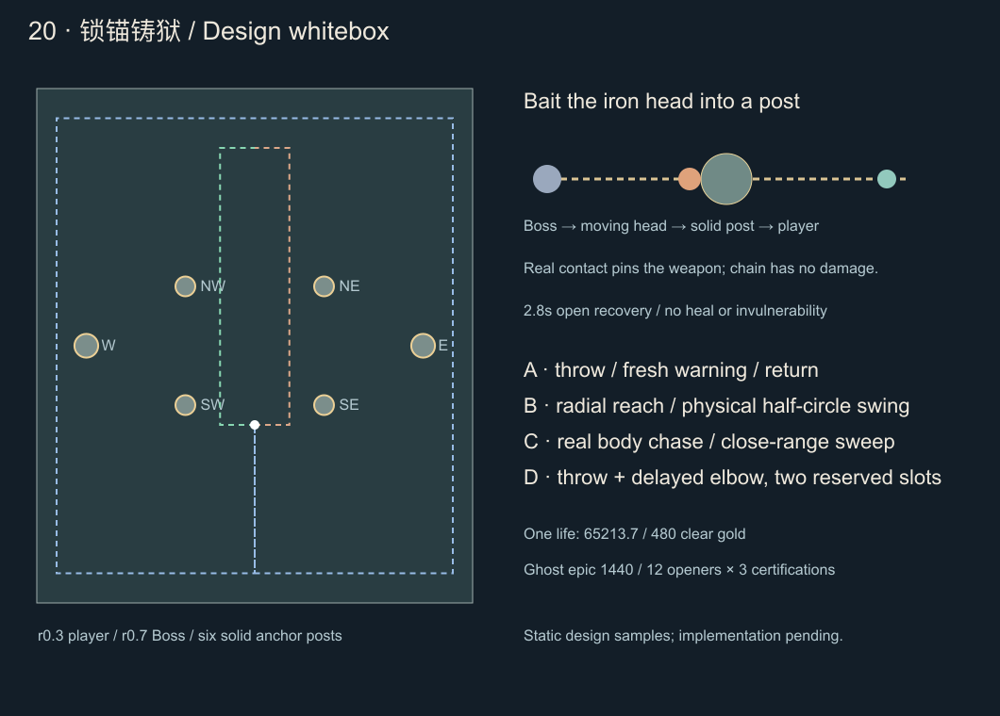

# 第二十关设计 · 锁锚铸狱

2026-10-22。**本批为设计与静态白盒，尚未开发、注册、开放或上传。** 当前本地0.43.0开放19关，微信开发后台已为0.43.0。依据[后续规则](level-design-rules.md)、[十九关实施](stage-19-implementation.md)与[数值预算](weapon-balance-0.33.6.md)。本关不是全游戏终局，不预排后续所有武器和成就。

## 1. 新的判断：诱导卡桩，再进场反击

十九关考“先拆掉哪个真实身体”，二十关考“怎样让敌人的武器自己失效”。单体Boss「牵链刑主」拖着一枚双齿重锚，直掷、摆锚和回收都有真实运动的锚头；玩家可侧移纯躲，也可诱导锚头撞上场内铁桩，获得明确的缴械窗口。

铁桩不是永久安全掩体。它挡链锚，不挡肘击、地面横扫或友方攻击；Boss会实际绕桩换角度，近身追击检验贴身与绕圈。难度来自移动时机、来回路线及卡桩后的进场选择，保留自动攻击、随机成长、四武器四被动和六分钟生存。没有新增按钮、护送或守点任务。

Boss单形态、单生命；不再加第三具身体、复活或额外血条。整场四组招式从开始均可用，按实际几何选取，不以血线强制三阶段。卡桩是可选收益，通关与金币进阶都不要求完成卡桩认证。

## 2. 数值与经济预算

继续直接调用 `StageGrowth.stageReference(20)`，不手填固定加血、不读取玩家即时DPS：

`D(n)=343+217×(1−exp(−(n−1)/5))`

`T(n)=60+60×(1−exp(−(n−1)/6))`

`H(n)=D(n)×T(n)`

|项目|第二十关候选|
|---|---|
|入口|ID20，通关19解锁；无需指定武器、品阶或成就|
|生存时间 / 人数上限|360秒 / 100敌人|
|特殊威胁 / 危险槽|6 / 2；未来已预约动作也计入|
|参考有效DPS / 目标Boss时间|555.145543 / 117.471369秒|
|Boss合计生命|65,213.707089，一条生命；比19关增长0.586658%|
|普通 / 精英成长|health=3.156587069，elite=3.784301215，仍只套一次生成成长及原型系数|
|接触伤害配置倍率 / XP倍率 / 药剂间隔|1.85 / 1.50 / 40|
|通关金币|480，最终胜利按runId只结算一次|
|Boss补给|累计实际损血25%/50%/75%各一瓶，共三瓶；卡桩不另发药|

参考时间是装备输出、护甲及可用输出窗口的校准目标，不是计时锁血。幽灵史诗加入后重测整队输出；若固定参考配装普遍偏离，应离线重估共享参考参数并说明影响，不给本关临时套隐藏倍率。高品阶、善用卡桩可以更快击杀，困难来自机制而非无限堆血。

## 3. 地图白盒

场地±22×±26，出生(0,−8)，玩家基础速度4.2、半径0.3，Boss及精英导航半径0.7。中心半径7内无柱；两条内侧通路x=±3.5和外环保持连通。

|铁桩|圆心|实体半径|
|---|---|---|
|西南 / 东南|(−7,−6) / (7,−6)|1.0|
|西北 / 东北|(−7,6) / (7,6)|1.0|
|西 / 东|(−17,0) / (17,0)|1.2|

铁桩不可摧毁、没有可攻击生命。它阻挡玩家、怪物身体和本关链锚头；友方所有武器、肘击/横扫判定正常越过，不暗中降低地面或远程配装收益。装饰锁链和桩间地纹无伤、不额外挡路；所有实体圆与碰撞、导航、出生、预告、卡桩求交共享同一份数据。

锚头以自身半径扩张圆桩，求真实运动路径的首接触；不能只检测中心线，也不能穿入桩后再回拉。墙边按锚头半径裁到首个边界，边界不算卡桩、不给缴械；发布前就显示实际裁后的终点，发布后不能凭空缩短。身体追击C必须整段可走，不能用同样裁短规则伪造到位。

镜头保持现有跟随比例，不为长锚缩小角色。选招前验证身体、完整预警及有效路径位于HUD安全区；出招体连续可见至少0.8秒。绘制必须容纳重锚和上身，避免十九关复核发现的高个身体被顶部HUD遮住。攻击不满足条件则真实换位，不在屏幕外无预告发出。

## 4. 链锚的共同生命周期

### 实体、预警与伤害

锚头从真实Boss身体出发，不从玩家脚下或悬空假点生成。直掷和回收按移动圆判伤，横摆按真实锚头沿圆弧的连续相对运动判伤；预告走廊、弧线包络、长链、停驻锚和回收演出无伤。锚头半径与玩家半径相加，不能把整条链当胶囊或把整个摆过扇面都判伤。

普通新锁定2.2秒，精英/Boss2.4秒；低帧从实际发布时刻计算完整预警。每次回收、追击到位后的横扫重新锁定方向，另给完整预警。锚头出程命中一次、回程命中一次；每个行程独立去重，同一帧跨过多个采样点不能多扣。横摆的出臂与半圈摆动属于同一次行程，合计只尝试命中一次。

一枚锚的预警、出臂/飞行、摆动、停驻、回收预警与回程共占一个预约槽，不能在等回收时把槽释放给第三条危险。D的肘击从组开始另占第二槽，未来锁定失败只撤肘击，不能更改已经发布的锚路。

### 卡桩与缴械

1. 活跃锚头首先撞上真实铁桩时，停在精确首接触点，立即关闭该锚伤害，并取消该锚未来回程；铁桩不消失，玩家不受装饰锁链伤害。
2. Boss未来未生效的同组肘击一起取消；已经进入0.20秒有效窗口的肘击仅完成原窗口。按实际事件时间排序：卡桩早于生效才撤未来，不能靠程序调用顺序吞掉已生效伤害。
3. 剩余已释放危险结束后，Boss进入完整2.8秒缴械恢复，保持可攻击。沿现有恢复护甲规则降到15%，不额外叠新易伤倍率、不锁血、不回血、不发药。UI显示“卡桩 · 缴械2.8秒”。
4. 锚头在恢复期内用0.6秒无伤回拽演出复位；不能在缴械结束前重新出招或因回拽另打一段伤害。每组最多一次卡桩奖励。
5. 普通掷锚/摆锚单位卡桩恢复1.0秒，牵锚精英2.4秒；不使其他真实精英停止已发动作。Boss与精英搭档的区别必须在提示和演出中可读。

卡桩不能自动反证“玩家躲得好”：成就另检查无遮挡时真实锚头确实会命中，避免站在很远处看武器碰桩也记认证。普通战斗中的物理卡桩仍正常生效，不为成就改变碰撞。

### 暂停、冻结、死亡与状态切换

链锚始终与主人相连，不是自由飞矢。主人冻结/死亡时立即停止当前锚头伤害、身体突进和未来段；掉链及回拽是无伤演出，冻结后不恢复旧危险。已释放的短肘击/横扫只完成原0.20秒窗口，不能因冻结延长。暂停、升级、后台挂起均不推进预警、运动、恢复或认证。需要覆盖上一帧武器冻结、下一帧玩家运动跨生效点的真实世界更新顺序。

## 5. Boss「牵链刑主」四组招式

轮廓为低肩宽体、单臂链鼓、另一臂铰刃，脚部是铸铁支架；无日军式军帽、制服或写实人形士兵。双齿重锚有明显实体外缘，细链压低亮度。卡桩时重锚外齿扣在铁桩上，单臂被牵开、胸口甲缝打开，恢复末端真实收回，不用换色代替动作。

下表伤害为**最终固定技能伤害**，不再乘1.85接触倍率；普通接触22、攻击组内关闭额外接触叠伤。导航半径0.7与冲锋伤害半径分开。

|组|实际动作、时钟及判定|伤害|正常完整恢复|
|---|---|---|---|
|A 直掷牵返|当前身体锁定直线；2.4秒后锚头出程，最大7、速度5.2、半径0.48；到端点停驻，原地重新预警2.4秒，再沿原直线回到始终驻足的本体，速度5.2|出程26 / 回程24|5.6×0.35=1.96秒|
|B 半环摆锚|锁定玩家方向θ；2.4秒后从身体沿θ−90°真实伸锚3.2，耗时0.5秒；随后锚头以身体为轴，0.8秒摆到θ+90°，半径0.48；到位重新预警2.4秒，直线回收，速度5.2|伸臂＋摆动共26 / 回程24|5.8×0.35=2.03秒|
|C 铰步追劈|身体沿锁定方向突进3.4，速度4.6、伤害圆半径0.55；真实到位后按当前玩家方向重新预警2.4秒，有限扇形半径3、半角70°、有效0.20秒|突进26 / 横扫28|6.0×0.35=2.10秒|
|D 架索并肘|组开始预约两槽。链锚同A先锁定；0.9秒后从仍驻足的真实本体另锁肘击方向，完整预警2.4秒；肘击半径2.8、半角80°、有效0.20秒；链锚照常回收，整组释放结束才恢复|锚26/24 / 肘28|6.4×0.35=2.24秒|

B的身体驻足，θ及弧路公布后不追玩家。弧路含真实伸出、连续半圈、停驻及回收起点；不能把头直接放到弧起点。桩截断后不再激活弧的剩余部分。C的铰刃始终随真实身体，不受卡锚规则影响；身体不能冲进桩、穿过墙或被取消后瞬移到终点。

D在第二锁定时重查肘击范围、视口和与锚路的联合退路；取消未来肘击时，已发锚保持原路线、时钟和返回规则。成功卡锚可主动拆掉尚未释放的肘击，形成“先制造窗口再输出”的策略收益。

### 选招、反挂机与公平性

- 先验证完整真实计划，再发布；A/B/C各预约1槽，D预约2槽。连续无效候选不消耗轮换；只有实际发布才记账。
- 对同一铁桩连续卡锚后，下次优先实际绕到该桩侧面，寻找到玩家的清晰角度；不能强行穿桩、取消卡桩收益或让锚忽然免碰撞。不读取站定时长触发追杀，也不读取玩家装备临时反制。
- 单次换位最多1.5秒，重试间隔3秒；失败尝试其他合法组。C为近身、障碍旁的补充，但完整路径不合法就不得截短硬放。
- B可进内侧躲真实摆头；A回程检验第一击后立刻返原位；C及D检验贴身/绕背。D未必要每轮出现，非法时退回单组；持续远离且整组无威胁时先接近，不重复对空气挥舞。
- 绕圈仍可以是有效走位，但不能让中心、贴边、角落、桩后、贴身或第一击间隙的静止位置永远不受任何招威胁。要对这类位置分别记录真实出招、伤害、身体路线和拒绝原因，修站位与选招，不增大隐藏判定。

## 6. 敌群与六分钟编排

独立阵营采用链节、铸渣、开口锚爪与低肩支架。基础追兵可复用追击框架，特殊怪分别提前教直掷、真实摆头与短突进，不复制一套染色攻击。

|候选ID / 名称|生命系数 / 速度|接触基础值 / XP|威胁 / 上限|技能与职责|
|---|---|---|---|---|
|chaincinder 铸灰役|1.30 / 1.94|12 / 1|0 / 100|基础近战；90秒生成成长封顶，护甲20%|
|anchorhand 掷锚徒|2.45 / 1.10|14 / 2|2 / 2|直掷5.8、速度4.6、半径0.32；到位重新预警2.2秒回收；22/20，正常恢复1.4秒|
|shacklefan 摆索卫|2.45 / 1.12|14 / 2|2 / 2|伸臂2.4耗时0.5秒、真实摆120°耗时0.8秒；半径0.32；无有伤回程，整程22，恢复1.3秒|
|ironknuckle 扣铰拳卫|2.50 / 1.16|14 / 2|2 / 1|实体突进2.4、速度3.8、伤害半径0.42，单程22，恢复1.2秒|
|anchorwarden 牵锚狱监|12.8 / 1.18|24 / 8|3 / 1|A直掷6.4、速度4.8、半径0.42；B伸臂2.8/0.5秒＋半圈0.9秒后重新预警回收；24/22；恢复5.6×0.35|
|lockmarshal 截步刑监|13.2 / 1.16|26 / 8|3 / 1|C实体突进3、速度4.4、伤害半径0.5；到位全预警后扫2.8/半角70°/0.20秒；26/26，恢复5.8×0.35|

特殊/精英生成成长240秒封顶，护甲分别35%/50%；Boss55%。恢复与裂甲沿既有规则，不叠缴械专属倍率。所有精英初登场和返场为同时间正常生成生命100%，不乘轮次折扣或加成。

|时间|教学、压力与休整|
|---|---|
|0～30秒|基础追兵，识别六桩可绕行与中心双通道|
|30～65秒|掷锚徒单职责，先学躲锚与回程，再观察卡桩|
|65～95秒|摆索卫单职责，预告弧与真实移动锚头明显区分|
|95～125秒|扣铰拳卫，教学实体追击；降低基础数量避免新招堆叠|
|125～135秒|只补少量基础怪，收割、回收|
|135秒|第一精英牵锚狱监，单独练引锚与缴械|
|145～205秒|已教普通角色轮换；同时最多两种，不自动塞满所有上限|
|215～225秒|休整；225秒截步刑监，单独练到位后的二次全预警|
|235～295秒|直掷/短突进与摆锚/近侧追击分别组合；威胁≤6|
|295～305秒|休整；305秒牵锚返场，311秒截步返场，均正常满血|
|350秒起|停止普通特殊新生成，已发段按原时钟结束后退场；无额外击杀、XP或药剂|
|360秒起|等精英、已发危险清空且交接3秒后，Boss可读到场2秒；不补播错过轮次|

第三轮实际出场若被旧精英/预算阻止，牵锚最晚328、搭档最晚334秒；第二名需晚于第一名至少6秒。双精英从组开始各占1槽，首发实际轮换，第二名0.9秒后重新锁定并给全预警；不满足配合则有限换位后各自合法出招。卡住牵锚者不冻结截步者，避免把双人配合说成全场安全缴械。

Boss阶段只补铸灰役，目标24～28、每3秒最多6只、9秒补/5秒停；正常恢复与缴械恢复期间停止补兵。不要再叠18关护甲支援或19关另一只Boss。低配置需要测100敌人、长弧预告与实际求交的帧耗，装饰链优先降级，判伤精度不因特效档位改变。

## 7. 成就与幽灵史诗

候选新增2成就（34→36），仍14武器系列；幽灵新增史诗1形态（35→36），本关不加新系列，现有武器已覆盖单体、清群、近身与辅助职责。

### 「锁锚止刑」 `chainforge_clear`

最终击败单体Boss，记录通关章。卡桩次数和使用何种武器都不限制，480金币仍只走胜利结算，不因通关章额外重复发。

### 「十二途断索」 `chainforge_twelve_paths`

冻结当版14系列，任选12种实际起手；每种完成以下三种不同认证，最少36份起手/路线认证，比十九关24份增加50%。难度增加来自两种诱导手法与无缴械对决，不是把同一种胜利再翻倍刷。

|认证键|真实条件|
|---|---|
|throw_pin 直掷借桩|A或D的有伤出程真实撞桩至少2次，涉及至少2根不同桩；每次都满足无遮挡锚头会命中、原本玩家站位有威胁；在完整缴械窗口内近身装备反击|
|swing_pin 横摆借桩|B真实伸出/摆动锚头撞桩至少2次、至少2根不同桩，同样满足无遮挡威胁及缴械近身反击；回程碰桩不计本路线|
|free_duel 无桩正解|整场Boss没有任何物理卡桩，A/B/C/D每组均完整躲过、真实有威胁并在整组恢复期近身装备反击|

所有认证还需：起手8级、保留两项当版合法改造、最终胜利、全场Boss来源实际扣血0；A/B/C/D各至少一组真实有效处理并恢复反击。有效卡桩可作为对应A/B/D的机制完成，要求**实际首接触阻断攻击且反击成功**，不能用“取消了未来段”一概误判成失败，也不能把普通冻结或非法撤招当作卡桩。

一次运行最多绑定一个认证：第一份完成“有效卡桩＋近身反击”的出程决定throw/swing路线，之后不切换或一局补两路；只有整战零物理卡桩才可能走free_duel。HUD提前说明“首次合格卡桩绑定路线”，显示绑定模式、不同桩数量、A/B/C/D进度和Boss受伤条件，不新增玩家选择按钮。

无遮挡威胁按原已发布锚轨做无伤影子验证：只关闭被撞这根桩对该锚的拦截，保留原时钟、路线及世界边界，用同时间玩家实际连续轨迹求交；不能用整条预告包络、锁定瞬间站位或地图边界代替。影子只用于该次认证，不绘制为攻击、不扣血、不占槽。卡桩时先暂存该组恢复反击证据，在原出程/摆动窗口内证明确会命中后才提交；若玩家提前离开使影子也未碰到则不给这次高难认证，实际缴械收益不变。记录有严格原窗口寿命，不跨局保存玩家轨迹。

近身为反击时玩家到Boss实际身体≤2.8，来源为已装备武器、正实际伤害；无伤害控制、装饰命中、纯裂甲回调不算。碰撞但被无敌抵消的那组不能算成功躲招；全场无伤还检查卡桩、回收、肘击与短扫的Boss归属，不因锚对象移除漏记。奖励「断索铸狱者」称号/三齿断环徽章，无属性或抽取权重。

认证保存候选为 `chainPathsVersion:1` 与 `chainPaths:Partial<Record<Skill,('throw_pin'|'swing_pin'|'free_duel')[]>>`，冻结14系列、每系列最多3个合法去重键。同一runId只结算一次，旧通关不补造认证，不扩大十九关及此前挑战范围。详情列出每系列三个中文路线勾选与完成系列数；坏版本/坏可选字段只修对应字段，金币、进阶、通关和三个手动位保留。

### 幽灵稀有→史诗「缚星冥将」

金币1,440，接在已实现的巡猎冥卫之后，倍率2.05。普通→精良→稀有→史诗价格继续360/720/1440；从普通升全阶合计2,520，20关从零六胜2,880余360。已有稀有时三胜1,440正好升级；两胜960尚差480。高难36认证只给荣誉，不把购买史诗绑在其后。

形态改为悬浮三裂冠、分层肋甲和双弯刃爪，驻队显示收拢披甲，出猎时展开刃翼与分叉灵尾，回队有断环收束轨迹；图鉴与HUD图标、两次爪击、haunt/reap等派生均有同一史诗形态。**只提高伤害**，同伴数量、出手周期、追击速度、范围、两次爪击、索敌、一次死亡转火和回队时钟保持。不可顺便新增破甲、控制、必中、跨屏追杀或第三爪。

沿幽灵单体追杀参考85～125×2.05，史诗8级无被动/改造预算174.25～256.25；实际角色加成和场景口径需与既有预算一致，不当运行时伤害上限。所有合法双改、复制/范围/持续/冷却组合、单/双目标、运动/护甲、死亡转火和四槽整队重新测；派生继承一次品阶，不放大覆盖。消费、取消、重复确认、实际图标及冷重载通过前，不开放史诗购买。图鉴保留简介和升级小图标。

## 8. 实现边界与验收

建议独立 `ChainforgeSystem/Director/Geometry/Map/Challenge`，通过StageStrategy、生命周期、StageHud、AchievementRules接入；几何模型统一描述出臂、直掷、弧段、停驻、回收、首接触和取消时间。不要再把本关判断堆入通用世界或存档分支。沿十九关Cocos经验，依赖世界参数的子对象在构造体内用参数创建，避免字段初始化早于参数属性赋值。

开发至少覆盖：

- 两种身体半径下通路与出生；完整摆弧、锚头半径扩张圆桩首交点、世界边界与HUD失败；出臂真实路径、弧心内安全区、旧链/停锚无伤；不能以预告包络代替伤害。
- 低帧连续运动；出回程去重；同帧卡桩/肘击/玩家命中按真实时间排序；前帧冻结与下帧跨生效；再次冻结不恢复旧锚。冻结死亡断源、已发短扫原寿命、暂停/退出不推进。
- D先预约两槽、第二次实际锁定、新全预警、联合退路失败只撤未来；单锚等待回收期间不释放容量；双精英首发连续轮换、不同来源、原生命100%。
- 中央/贴边/角落/桩后/贴身/返原位，移动与站定、同种子多配装；反复卡同桩后的真实换位；C非法路径不能截短。保留超时、死因及拒绝原因，不要求机器人必须通关。
- 真正卡桩与无桩对决各一局实际认证，反事实威胁、不同桩、首次绑定、碰撞无敌、缺招、死亡取消、重复胜利及旧档；高输出过早击败允许正常通关，不锁血等认证。
- 实际Cocos横屏844/740、史诗图标/驻队/出猎/双爪/派生/回队、三手动位、老账户冷加载；内容审计、完整回归、Web/微信本地构建。真人随机成长难度与微信真机性能另行验证。

## 9. 已完成的设计白盒及其限制

执行 `node tools/check-stage20-design.mjs`，输出[PNG](../artifacts/stage20-design/layout.png)、[SVG](../artifacts/stage20-design/layout.svg)及[静态报告](../artifacts/stage20-design/whitebox.json)。0.5网格玩家8,827格、Boss8,347格均连通，两个内侧通路和外环通过。中心/边缘/角落/桩旁×A/B/C/D共16组孤立120Hz示例找到基础移速、0.35秒反应后的避让路径，示例计入实体接近危险与C的真实到位后重新锁向。直掷与横摆各一组真实圆桩首接触样例，通过“有桩安全、只移除武器拦截后会命中”的对照。

这只是设计可行性初筛，未注册20关、未新增商品或存档字段；未跑真实战斗导演、完整AI、全部地形/视口、伤害帧序、武器队伍、挑战全流程或真机。120Hz离散弧样例不替代运行时连续求交与低帧验收，也不能据此宣称反挂机、36认证可完成性或真人难度已通过。后续开发先验证实体首接触与缴械，再扩到组合、成长及表现。
